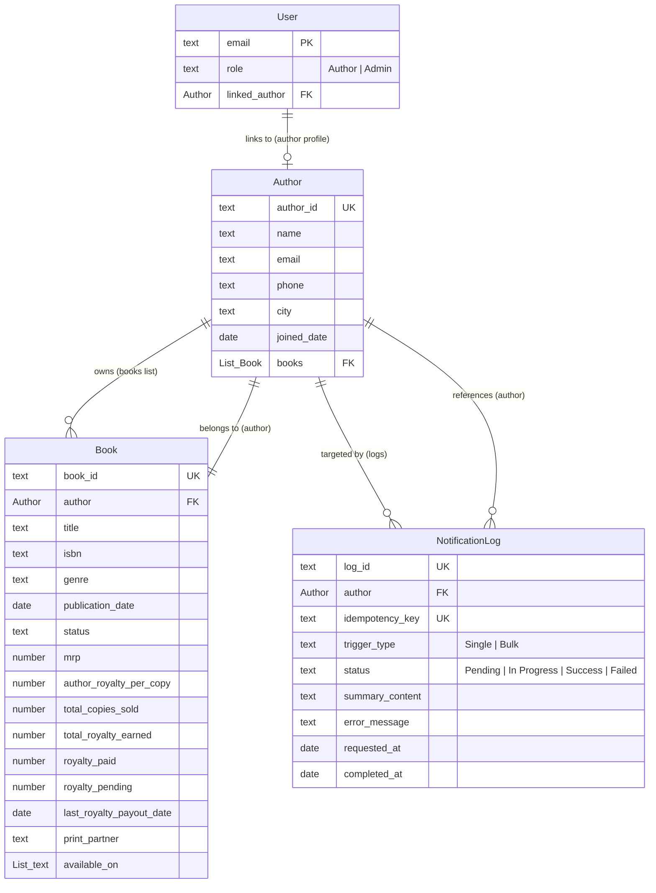

# BookLeaf Author Royalty Dashboard & Automated Notification System
## Architectural Implementation Plan

**Role:** Senior Full-Stack Technical Architect & Automation Engineer  
**Platform:** Bubble.io + n8n + AI API (OpenAI / Anthropic / Gemini)  
**Specification:** BookLeaf Technical Assignment 2 & Assignment 1 Knowledge Base  
**Status:** Comprehensive Architecture & Implementation Specification  

---

## 1. Project Overview & System Responsibilities

### 1.1 Objective
BookLeaf Publishing operates an active self-publishing catalog of 22,000+ titles and manages over 1,200 new books monthly across India and the US. Author communication regarding royalties, production statuses, and distribution constitutes a major operational workload.

This project plans and specifies an end-to-end **Author Royalty Dashboard & Automated Notification System** consisting of:
1. An **Author Portal** (Bubble.io) providing self-service transparency into book catalog details, sales counts, earned/paid/pending royalties, and visual payout status badges.
2. An **Admin Portal** (Bubble.io) enabling BookLeaf operations to view, search, and filter all authors, inspect author portfolios, and trigger individual or bulk AI-generated royalty summary emails.
3. An **Automation Engine** (n8n) orchestrating secure webhooks, deterministic financial aggregation, prompt formatting grounded in BookLeaf's policies, automated guardrail validation, and bidirectional status updates to Bubble.
4. An **AI Generation Service** producing personalized, professional, and empathetic email summaries adhering strictly to BookLeaf's Knowledge Base and Tone Guidelines.

---

### 1.2 Architectural System Boundary & Component Responsibilities

```
+-----------------------------------------------------------------------------------------+
|                                    BUBBLE.IO PLATFORM                                   |
|                                                                                         |
|  +--------------------+  +--------------------+  +-----------------------------------+  |
|  |   Author Portal    |  |    Admin Portal    |  |        Bubble Relational DB       |  |
|  | - My Books         |  | - Author Directory |  | - User (Native Auth & Roles)      |  |
|  | - Royalty Overview |  | - Search & Filters |  | - Author (10 Records)             |  |
|  | - Status Badges    |  | - Single/Bulk Trig |  | - Book (18 Records)               |  |
|  | - Privacy Isolation|  | - Notification Log |  | - NotificationLog (Audit Trail)   |  |
|  +--------------------+  +--------------------+  +-----------------------------------+  |
|             \                      /                                |                   |
|              \                    /                         [Privacy Rules]             |
|               v                  v                                  |                   |
|          +----------------------------+                             |                   |
|          |    Bubble API Connector    |                             |                   |
|          | (Outbound POST with Secret)|                             |                   |
|          +----------------------------+                             |                   |
|                         |                                           |                   |
|                         | POST Webhook                              |                   |
+-------------------------|-------------------------------------------|-------------------+
                          |                                           |
                          v                                           | POST Callback
+-------------------------------------------------------------+       | (Update Log)
|                        N8N ENGINE                           |       |
|                                                             |       |
|  [Webhook Trigger]                                          |       |
|         |                                                   |       |
|  [Header & Payload Auth Validation]                         |       |
|         |                                                   |       |
|  [Respond 202 Accepted to Bubble]                           |       |
|         |                                                   |       |
|  [Idempotency & Collision Check]                            |       |
|         |                                                   |       |
|  [Deterministic Data Prep & Math Node]                      |       |
|         |                                                   |       |
|  [AI Context Formatting (Assignment 1 Policies)]            |       |
|         |                                                   |       |
|         v                                                   |       |
|  [LLM Chat Node] <----------> [AI API: OpenAI/Gemini/Groq]  |       |
|         |                                                   |       |
|  [Automated Guardrails & Schema Check]                      |       |
|         |                                                   |       |
|  [Dispatch Callback to Bubble Workflow API] ----------------+-------+
|  [Centralized Error Catch Branches]                         |
+-------------------------------------------------------------+
```

#### Detailed Responsibilities:
- **Bubble.io (Application Frontend & Database):**
  - Responsive web interface for Authors and Admins.
  - Native authentication (`User` type with bcrypt hashing) and role-based access control (`Admin` vs `Author`).
  - Database-level Privacy Rules protecting all read and search queries.
  - Outbound webhook calls to n8n via Bubble API Connector.
  - Inbound status updates via Bubble Backend Workflow API (`update_notification_log`).
- **n8n (Orchestration & Workflow Backend):**
  - Ingress webhook receiver validating shared secret authentication headers.
  - Immediate `202 Accepted` response decoupling Bubble client UI from long-running tasks.
  - Deterministic data formatting, INR currency styling, and calculation of totals.
  - Injection of BookLeaf Knowledge Base policies into system prompts.
  - Automated output validation (sanity checks on name, figures, and formatting).
  - Outbound callback to Bubble Backend Workflow API to record `Success` or `Failed` status.
- **AI API (Personalized Content Generation):**
  - Generates personalized, professional royalty summary emails.
  - Bound by strict constraints: forbidden from performing math, inventing dates, or claiming false transfers.

---

## 2. Requirements Inventory

| Req ID | Category | Description | Priority | Component | Acceptance Criteria |
| :--- | :--- | :--- | :--- | :--- | :--- |
| **DB-01** | Database | Define relational schema (`User`, `Author`, `Book`, `NotificationLog`). | Critical | Bubble | Clean tables with bidirectional relations and appropriate field types. |
| **DB-02** | Database | Import sample dataset with zero data modification or record fabrication. | Critical | Bubble | Exactly 10 Author records and 18 Book records verified. |
| **DB-03** | Database | Support nullable fields (dates, prices) and multi-item list (`available_on`). | High | Bubble | Nulls preserved; `available_on` stored as `List of texts`. |
| **AUTH-01** | Auth | Author email/password login using Bubble native authentication. | Critical | Bubble | Authors log in with test credentials and are routed to `/author-dashboard`. |
| **AUTH-02** | Auth | Admin authentication with elevated administrative role flag. | Critical | Bubble | Admins log in and are routed to `/admin`. |
| **AUTH-03** | Privacy | Enforce data isolation via Bubble Privacy Rules. | Critical | Bubble | Author A cannot view Author B's books or records in search/network payloads. |
| **AUTHOR-01**| Author Portal | "My Books" catalogue displaying Title, ISBN, Genre, Status, PubDate, MRP, Platforms. | High | Bubble | Renders only books owned by the logged-in author. |
| **ROYALTY-01**| Royalty UI | Per-book breakdown: Sold, Earned, Paid, Pending, Last Payout Date. | Critical | Bubble | Exact figures displayed matching source dataset. |
| **ROYALTY-02**| Royalty UI | Consolidated summary banner: Total Earned, Total Paid, Total Pending. | High | Bubble | Sum matches total across all linked books. |
| **ROYALTY-03**| Status Badge | Green Status Badge: Fully paid (`royalty_pending == 0`). | High | Bubble | Displayed when pending royalty is 0. |
| **ROYALTY-04**| Status Badge | Yellow Status Badge: Pending amount exists, within normal payout cycle. | High | Bubble | Displayed when pending > 0 and overdue conditions false. |
| **ROYALTY-05**| Status Badge | Red Status Badge: Overdue (pending > 0 and last payout > 90d ago OR pub date > 90d ago with 0 payouts). | Critical | Bubble | Correctly triggers on overdue books; does not trigger on production books. |
| **ADMIN-01** | Admin Portal | Author directory table: Name, City, Books Count, Total Earned, Total Pending, Status. | Critical | Bubble | Displays all 10 authors with accurate roll-up figures. |
| **ADMIN-02** | Admin Portal | Search author directory by author name with real-time text matching. | High | Bubble | Filters repeating group on partial string match. |
| **ADMIN-03** | Admin Portal | Filter author directory by City dropdown (dynamically populated). | High | Bubble | Filters repeating group by selected city. |
| **ADMIN-04** | Admin Portal | Filter author directory by Payout Status (`All`, `Fully Paid`, `Pending`, `Overdue`). | High | Bubble | Filters authors matching derived status. |
| **ADMIN-05** | Admin Portal | Author Detail View displaying author info, full book list, and payout metrics. | High | Bubble | Full profile view for any selected author. |
| **ADMIN-06** | Admin Portal | Single-author trigger button: "Generate & Send Royalty Summary". | Critical | Bubble | Calls n8n webhook; creates `Pending` log; updates to `Success`. |
| **ADMIN-07** | Admin Portal | Bulk trigger button: iterates over all authors with pending royalties > 0. | High | Bubble | Dispatches 1 webhook per eligible author; skips fully paid authors. |
| **ADMIN-08** | Admin Portal | Notification Log table showing Author, Request Time, Completion Time, Status, Summary, Error. | Critical | Bubble | Displays live lifecycle states (`Pending` -> `Success` / `Failed`). |
| **N8N-01** | Automation | Authenticated Webhook trigger receiving payload from Bubble. | Critical | n8n | Rejects unauthorized requests lacking `X-BookLeaf-Secret`. |
| **N8N-02** | Automation | Validate payload, check idempotency key, respond with 202 Accepted. | Critical | n8n | Immediate 202 response returned to Bubble within 500ms. |
| **N8N-03** | Automation | Normalization & financial validation node (deterministic calculation). | Critical | n8n | Formats currency, calculates totals, separates published vs production books. |
| **AI-01** | AI Engine | LLM prompt grounded in BookLeaf Knowledge Base (80/20 split, quarterly cycle, 45d window). | Critical | AI / n8n | Prompt contains accurate operational policies; forbids hallucinations. |
| **AI-02** | AI Engine | Personalized summary email with greeting, book breakdown, totals, next steps, BookLeaf tone. | Critical | AI / n8n | Empathetic, professional email matching BookLeaf communication tone. |
| **AI-03** | AI Engine | Handle edge cases: Zero payouts, books in production, pending < ₹1,000 threshold. | High | AI / n8n | Addresses production stages and threshold rollover policy without error. |
| **AI-04** | AI Guardrail | Automated validation of AI output (schema, length, author name check, financial sanity). | High | n8n | Rejects empty output or mismatched author data. |
| **N8N-04** | Automation | Asynchronous callback to Bubble Backend Workflow API updating `NotificationLog`. | Critical | n8n | Posts status `Success`, completion timestamp, and email text to Bubble. |
| **N8N-05** | Error Handling| Centralized error branch catching API timeouts, bad payloads, and LLM failures. | Critical | n8n | On error, callback posts status `Failed` with diagnostic message. |
| **SEC-01** | Security | Shared secret / Bearer token authentication between Bubble and n8n (both directions). | Critical | Shared | Unauthorized requests return HTTP 401. |
| **TEST-01** | Testing | Comprehensive acceptance test suite covering dataset, privacy, calculations, and errors. | Critical | All | 100% pass rate documented with proof. |
| **SUB-01** | Submission | Prepare Bubble access, n8n JSON export, README, and 3-5 min video. | Critical | Docs | All 4 required deliverables packaged according to assignment specs. |

---

## 3. Dataset Analysis & Data Inventory

### 3.1 Dataset Verification
- **File:** `FULLSTACK-SAMPLEDATA (1) (1) (1).json`
- **Root Element:** JSON Object with single key `"authors"`.
- **Verified Record Counts:** Exactly **10 Authors** and **18 Books**.
- **Financial Consistency:**
  - `total_royalty_earned == total_copies_sold * author_royalty_per_copy` holds true across all 18 books.
  - `total_royalty_earned == royalty_paid + royalty_pending` holds true across all 18 books.
  - Catalog Grand Totals: Earned = **₹243,382**, Paid = **₹202,543**, Pending = **₹40,839**.

### 3.2 Complete Author & Book Catalog Matrix

| Author ID | Author Name | City | Joined Date | Book ID | Book Title | Status | Sold | Earned (₹) | Paid (₹) | Pending (₹) | Last Payout Date | Status Badge |
| :--- | :--- | :--- | :--- | :--- | :--- | :--- | :--- | :--- | :--- | :--- | :--- | :--- |
| **AUTH001** | Priya Sharma | Mumbai | 2023-03-15 | BK001 | Whispers of the Ganges | Published & Live | 342 | 11,970 | 8,400 | 3,570 | 2025-10-15 | **Yellow** |
| | | | | BK002 | The Saffron Diaries | Published & Live | 189 | 7,938 | 7,938 | 0 | 2025-12-01 | **Green** |
| **AUTH002** | Rohit Kapoor | Delhi | 2022-11-08 | BK003 | Code & Karma | Published & Live | 876 | 26,280 | 21,000 | 5,280 | 2025-09-01 | **Red** (>90d) |
| | | | | BK004 | Startup Sutra | Published & Live | 1,203 | 57,744 | 50,000 | 7,744 | 2025-11-15 | **Yellow** |
| **AUTH003** | Ananya Reddy | Hyderabad | 2024-02-20 | BK005 | Between Two Temples | Published & Live | 67 | 2,546 | 0 | 2,546 | *None* | **Red** (No payout, >90d) |
| **AUTH004** | Vikram Joshi | Pune | 2023-07-12 | BK006 | Debugging Life | Published & Live | 534 | 13,350 | 10,000 | 3,350 | 2025-08-20 | **Red** (>90d) |
| | | | | BK007 | The Last Monsoon | Published & Live | 123 | 1,845 | 1,845 | 0 | 2025-12-01 | **Green** |
| **AUTH005** | Meera Nair | Kochi | 2023-01-05 | BK008 | Cardamom & Chaos | Published & Live | 445 | 14,240 | 14,240 | 0 | 2025-12-01 | **Green** |
| | | | | BK009 | Letters from Lakshadweep | Published & Live | 201 | 11,055 | 8,000 | 3,055 | 2025-10-15 | **Yellow** |
| **AUTH006** | Arjun Malhotra | Chandigarh | 2024-06-01 | BK010 | Turban Tales | Published & Live | 88 | 2,464 | 0 | 2,464 | *None* | **Red** (No payout, >90d) |
| **AUTH007** | Sneha Kulkarni | Bangalore | 2022-09-18 | BK011 | The Algorithm of Love | Published & Live | 1,567 | 39,175 | 35,000 | 4,175 | 2025-11-15 | **Yellow** |
| | | | | BK012 | Ctrl+Alt+Delete My Ex | Published & Live | 723 | 21,690 | 18,000 | 3,690 | 2025-10-15 | **Yellow** |
| | | | | BK013 | Midnight in Mysore | In Production - Cover Design | 0 | 0 | 0 | 0 | *None* | **Green / N/A** |
| **AUTH008** | Farhan Sheikh | Lucknow | 2023-10-01 | BK014 | Ghazal of the Forgotten | Published & Live | 156 | 3,120 | 3,120 | 0 | 2025-12-01 | **Green** (Fully Paid) |
| **AUTH009** | Kavita Deshmukh | Nagpur | 2024-04-10 | BK015 | Raising Roots | In Production - Typesetting | 0 | 0 | 0 | 0 | *None* | **Green / N/A** |
| | | | | BK016 | The Nagpur Notebooks | Published & Live | 34 | 850 | 0 | 850 | *None* | **Yellow** (<₹1k cycle) |
| **AUTH010** | Diya Chatterjee | Kolkata | 2023-05-22 | BK017 | Durga’s Daughters | Published & Live | 612 | 27,540 | 25,000 | 2,540 | 2025-11-15 | **Yellow** |
| | | | | BK018 | Howrah Nights | Published & Live | 45 | 1,575 | 0 | 1,575 | *None* | **Yellow** (Recent pub) |

### 3.3 Critical Edge Cases in Data
1. **Books in Production (`BK013`, `BK015`):**
   - Publication status is `"In Production - Cover Design"` and `"In Production - Typesetting"`.
   - `publication_date`, `mrp`, `author_royalty_per_copy`, `last_royalty_payout_date`, and `print_partner` are `null`.
   - `available_on` is empty `[]`.
   - *Handling Rule:* Database fields must be nullable; UI must display `"In Production"` badge rather than broken calculations; status badges must not mark these books as "Overdue".
2. **Published Books With No Prior Payout (`BK005`, `BK010`, `BK016`, `BK018`):**
   - `last_royalty_payout_date` is `null`.
   - *Handling Rule:* If `publication_date` is > 90 days ago and pending > 0, status is **Red (Overdue)** (`BK005`, `BK010`). If published recently and pending is below threshold (`BK016`), status is **Yellow (In Cycle)**.
3. **Pending Balance Below ₹1,000 Threshold (`BK016` - Kavita Deshmukh):**
   - Pending balance is ₹850. BookLeaf policy requires a ₹1,000 minimum payout threshold.
   - *Handling Rule:* AI prompt must explain that the ₹850 balance rolls over to the next quarter rather than claiming an immediate bank disbursement.
4. **Author With Zero Pending Royalties (`AUTH008` - Farhan Sheikh):**
   - Total pending across catalog is ₹0.
   - *Handling Rule:* Excluded from Admin Bulk Trigger; in single trigger, AI summary provides a positive acknowledgement celebrating that all royalties are paid up to date.

---

## 4. Proposed Bubble Database Schema

### 4.1 Schema Rationale
Bubble’s database uses a relational document hybrid structure. To maximize performance in Repeating Groups, bidirectional relationships are implemented: `Author` maintains a `List of Books`, and `Book` stores an `author` reference. This allows fast queries for both Author Portal views and Admin aggregation tables.



### 4.2 Entity Field Definitions

#### Entity: `User` (Bubble Built-In Extended)
- `email` (`text`, Required): User login email.
- `role` (`text`, Required): `"Admin"` or `"Author"`. Enforces RBAC.
- `linked_author` (`Author`, Optional): Links user account to author record. Empty for Admins.

#### Entity: `Author`
- `author_id` (`text`, Required, Unique): e.g. `"AUTH001"`.
- `name` (`text`, Required): Full legal name.
- `email` (`text`, Required): Contact email; matches `User.email`.
- `phone` (`text`, Required): Phone with country code.
- `city` (`text`, Required): City for admin filtering.
- `joined_date` (`date`, Required): Date joined.
- `books` (`List of Books`, Optional): Bidirectional multi-reference for fast queries.

#### Entity: `Book`
- `book_id` (`text`, Required, Unique): e.g. `"BK001"`.
- `author` (`Author`, Required): Parent author reference.
- `title` (`text`, Required): Book title.
- `isbn` (`text`, Required): ISBN-13 string.
- `genre` (`text`, Required): Book genre.
- `publication_date` (`date`, Optional): Null for books in production.
- `status` (`text`, Required): `"Published & Live"`, `"In Production - Typesetting"`, etc.
- `mrp` (`number`, Optional): Maximum Retail Price in INR. Null for in-production books.
- `author_royalty_per_copy` (`number`, Optional): Royalty rate in INR. Null for in-production books.
- `total_copies_sold` (`number`, Required): Default `0`.
- `total_royalty_earned` (`number`, Required): Default `0`.
- `royalty_paid` (`number`, Required): Default `0`.
- `royalty_pending` (`number`, Required): Default `0`.
- `last_royalty_payout_date` (`date`, Optional): Null if no prior payout occurred.
- `print_partner` (`text`, Optional): `"In-House"`, `"Repro India"`, `"Epitome Books"`, or null.
- `available_on` (`List of texts`, Optional): Distribution platforms list.

#### Entity: `NotificationLog`
- `log_id` (`text`, Required, Unique): Unique log identifier.
- `author` (`Author`, Required): Target author.
- `idempotency_key` (`text`, Required, Unique): Collision key preventing duplicates (`AUTH001_20261025`).
- `trigger_type` (`text`, Required): `"Single"` or `"Bulk"`.
- `status` (`text`, Required): `"Pending"`, `"In Progress"`, `"Success"`, `"Failed"`.
- `summary_content` (`text`, Optional): Generated email body returned by n8n.
- `error_message` (`text`, Optional): Diagnostic error details if workflow fails.
- `requested_at` (`date`, Required): Timestamp when triggered.
- `completed_at` (`date`, Optional): Timestamp when terminal callback received.

---

## 5. Authentication & Privacy Architecture

### 5.1 RBAC Implementation
- **Author Login:** Email/password authentication. The user's `role` is verified; if `"Author"`, they are redirected to `/author-dashboard`.
- **Admin Login:** Email/password authentication. If `role` is `"Admin"`, they are redirected to `/admin`.
- **Route Guards:** Page load workflows redirect unauthenticated or unauthorized users back to `/login`.

### 5.2 Bubble Privacy Rules

```
Entity: Author
  Rule: "Admin Full Access"
    Condition: Current User's role is "Admin"
    Permissions: [x] View all fields, [x] Find in searches
  Rule: "Author Self Access"
    Condition: Current User's linked_author is This Author
    Permissions: [x] View all fields, [x] Find in searches
  Default: "Everyone Else" -> [ ] All unchecked

Entity: Book
  Rule: "Admin Full Access"
    Condition: Current User's role is "Admin"
    Permissions: [x] View all fields, [x] Find in searches
  Rule: "Author Owns Book"
    Condition: Current User's linked_author is This Book's author
    Permissions: [x] View all fields, [x] Find in searches
  Default: "Everyone Else" -> [ ] All unchecked

Entity: NotificationLog
  Rule: "Admin Full Access"
    Condition: Current User's role is "Admin"
    Permissions: [x] View all fields, [x] Find in searches
  Default: "Everyone Else" -> [ ] All unchecked
```

---

## 6. Author Portal Implementation Plan

### 6.1 Views & Components
- **Top Summary Banner:** 3 metric cards aggregating all books owned by the author:
  - `Total Royalty Earned` (Sum of `author's books' total_royalty_earned`).
  - `Total Royalty Paid` (Sum of `author's books' royalty_paid`).
  - `Total Royalty Pending` (Sum of `author's books' royalty_pending`).
- **"My Books" Repeating Group:** Renders cards for each book owned by the author:
  - Title, ISBN, Genre, Publication Status, Publication Date, MRP, Platform Availability.
  - Performance: Copies Sold, Earned, Paid, Pending, Last Payout Date.
  - Visual Status Badge: Green, Yellow, or Red.

### 6.2 Status Badge Conditional Logic
1. **Green (Fully Paid):**
   - Condition: `This Book's royalty_pending is 0`
   - UI: Green badge with text `"Fully Paid"`.
2. **Red (Overdue):**
   - Condition:
     `This Book's royalty_pending > 0` AND (
       (`This Book's last_royalty_payout_date is not empty` AND `This Book's last_royalty_payout_date < Current date/time +(days): -90`) OR
       (`This Book's last_royalty_payout_date is empty` AND `This Book's status is "Published & Live"` AND `This Book's publication_date < Current date/time +(days): -90`)
     )
   - UI: Red badge with text `"Overdue"`.
3. **Yellow (Pending within Cycle):**
   - Condition: `This Book's royalty_pending > 0` AND NOT (Red condition is true).
   - UI: Yellow badge with text `"Pending (In Cycle)"`.
4. **In Production:**
   - Condition: `This Book's status is not "Published & Live"`
   - UI: Blue/Gray badge with text `"In Production"`.

---

## 7. Admin Portal Implementation Plan

### 7.1 Author Directory & Filtering
- **Summary Header:** Total Authors (10), Total Books (18), Total Pending Royalties (₹40,839).
- **Search & Filters:**
  - Name Search: Text input filtering authors by partial name match.
  - City Filter: Dropdown dynamically populated with unique cities from the Author table.
  - Status Filter: Dropdown with choices: `All`, `Fully Paid`, `Pending`, `Overdue`.
- **Directory Table:** Name, City, Books Count, Total Earned, Total Pending, Derived Payout Status, and `"View Details"` button.

### 7.2 Author Detail View & Actions
- **Profile Header:** ID, Name, Email, Phone, City, Joined Date.
- **Book Breakdown Table:** Lists all books with sales figures, royalty metrics, and status badges.
- **Single Trigger Action:**
  - Button: `"Generate & Send Royalty Summary"`.
  - Action: Creates `NotificationLog` in `Pending` state, disables button to prevent double-clicks, and dispatches n8n webhook.

### 7.3 Bulk Trigger Action
- **Button:** `"Generate & Send Bulk Summaries"` on `/admin`.
- **Eligibility:** Filters authors where `total_pending > 0` (selects 9 authors, excludes `AUTH008` who has ₹0 pending).
- **Action:** Dispatches 1 webhook per eligible author with a 1-second delay between calls to respect rate limits.

### 7.4 Notification Log Table
- **Columns:** Target Author, Trigger Type, Requested At, Completed At, Status Badge (`Pending`, `In Progress`, `Success`, `Failed`), Actions.
- **Modals:**
  - `"View Summary"` button: Displays generated email text in a popup.
  - `"View Error"` button: Displays error diagnostics if status is `Failed`.

---

## 8. n8n Automation Architecture

### 8.1 10-Step Workflow Pipeline

```
[Step 1: Webhook Node (POST)]
       |
[Step 2: Validate X-BookLeaf-Secret Header]
       |---> Unauthorized -> Return 401
       |
[Step 2b: Respond 202 Accepted to Bubble]
       |
[Step 3: Validate Required Payload Fields]
       |
[Step 4: JavaScript Code Node - Deterministic Math & Formatting]
       |
[Step 5: Inject Assignment 1 Knowledge Base & Tone Policies]
       |
[Step 6: AI Node (OpenAI / Anthropic / Gemini)]
       |
[Step 7: Automated Guardrail Validation (Checks author name & pending figure)]
       |
       +---> Passed ---> [Step 8: Bubble Callback POST Success]
       |
       +---> Failed ---> [Step 9: Bubble Callback POST Failed]
```

### 8.2 Knowledge Base Policies Injected into AI Prompt
- **Royalty Split:** 80% net profit to author, 20% to BookLeaf.
- **Calculation Cycle:** Calculated quarterly; paid within 45 days of quarter end.
- **Minimum Payout Threshold:** ₹1,000. Balances below ₹1,000 roll over to next quarter.
- **Disbursement Method:** Direct bank transfer to linked account.
- **Communication Tone:** Empathetic, transparent, partner-first; specific numbers included; no defensive corporate language.
- **Negative Constraints:** Strictly forbidden from calculating numbers, inventing payout dates, or claiming unverified bank transfers.

---

## 9. Integration Contract & API Specifications

### 9.1 Bubble -> n8n Trigger Request
- **Endpoint:** `POST https://<n8n-domain>/webhook/bookleaf-royalty-summary`
- **Headers:** `X-BookLeaf-Secret: <SECRET>`, `Content-Type: application/json`
- **Payload Example:**
```json
{
  "event": "royalty_summary_requested",
  "notification_log_id": "LOG_AUTH001_1729864200",
  "idempotency_key": "AUTH001_20261025_SINGLE",
  "trigger_type": "Single",
  "author": {
    "author_id": "AUTH001",
    "name": "Priya Sharma",
    "email": "priya.sharma@email.com",
    "city": "Mumbai"
  },
  "books": [
    {
      "book_id": "BK001",
      "title": "Whispers of the Ganges",
      "isbn": "978-93-91234-01-2",
      "genre": "Literary Fiction",
      "publication_date": "2023-06-20",
      "status": "Published & Live",
      "mrp": 399,
      "author_royalty_per_copy": 35,
      "total_copies_sold": 342,
      "total_royalty_earned": 11970,
      "royalty_paid": 8400,
      "royalty_pending": 3570,
      "last_royalty_payout_date": "2025-10-15",
      "print_partner": "In-House",
      "available_on": ["Amazon India", "Flipkart", "BookLeaf Store"]
    }
  ]
}
```

### 9.2 n8n -> Bubble Final Callback
- **Endpoint:** `POST https://<bubble-domain>/version-test/api/1.1/wf/update_notification_log`
- **Headers:** `Authorization: Bearer <BUBBLE_API_TOKEN>`, `Content-Type: application/json`
- **Success Payload:**
```json
{
  "log_id": "LOG_AUTH001_1729864200",
  "status": "Success",
  "summary_content": "Dear Priya,\n\nHere is your latest royalty statement...",
  "completed_at": "2026-10-25T11:05:08.450Z",
  "error_message": null
}
```
- **Failure Payload:**
```json
{
  "log_id": "LOG_AUTH001_1729864200",
  "status": "Failed",
  "summary_content": null,
  "completed_at": "2026-10-25T11:05:15.890Z",
  "error_message": "AI model rate limit exceeded (HTTP 429)."
}
```

---

## 10. Security & Error Handling

- **Dual-Token Authentication:** Shared secret header for inbound webhooks; Bearer token for Bubble callbacks.
- **Zero Frontend Secrets:** No LLM API keys stored in client-side code; all secrets held in n8n environment variables.
- **Database Privacy Rules:** `User`, `Author`, `Book`, and `NotificationLog` protected at server level.
- **Idempotency Protection:** Active `In Progress` checks in Bubble and collision keys in n8n prevent duplicate runs on rapid double-clicks.
- **Centralized Error Handling:** Any API failure, rate limit, or guardrail violation routes to an error callback updating the log to `Failed`.

---

## 11. Acceptance Test Summary

- **25 Comprehensive Test Cases** covering:
  - Dataset integrity and null value preservation (`DS-01`, `DS-02`, `DS-03`).
  - Author data isolation and admin route protection (`PRIV-01`, `PRIV-02`, `PRIV-03`).
  - Consolidated calculations and Green/Yellow/Red status badges (`ROY-01` through `ROY-06`).
  - Admin search, filtering, and single/bulk triggers (`ADM-01` through `ADM-06`).
  - Webhook security and duplicate prevention (`N8N-01`, `N8N-02`).
  - AI personalization, accuracy, and edge-case handling (`AI-01` through `AI-05`).
  - Failure recovery and error logging (`ERR-01`).

---

## 12. Free Tools Strategy

- **Bubble.io:** Free Plan (development mode `version-test` supports complete database, UI, and Backend Workflows).
- **n8n:** Self-hosted via npm/Docker (genuinely free) or n8n Cloud 14-day free trial.
- **Tunneling:** Cloudflare Tunnel or ngrok free tier to expose local n8n webhooks to Bubble.
- **AI API:** Google AI Studio Gemini API free tier (no credit card required) or Groq free developer tier.
- **Offline Fallback:** Local mock summary generation node in n8n for development without API keys.

---

## 13. Submission Deliverables

1. **Bubble Application:** Live application URL and collaborator access granted to BookLeaf evaluation email. Test credentials: Admin (`admin@bookleaf.com`) and Author (`priya.sharma@email.com`).
2. **n8n Workflow Export:** JSON export file `bookleaf_n8n_royalty_workflow.json`.
3. **Documentation:** Comprehensive `README.md` explaining architecture, schema decisions, prompt strategy, and learning process.
4. **Screen Recording:** 3–5 minute video demonstrating Author Portal, Admin Portal, triggers, n8n workflow execution, and notification log updates.
