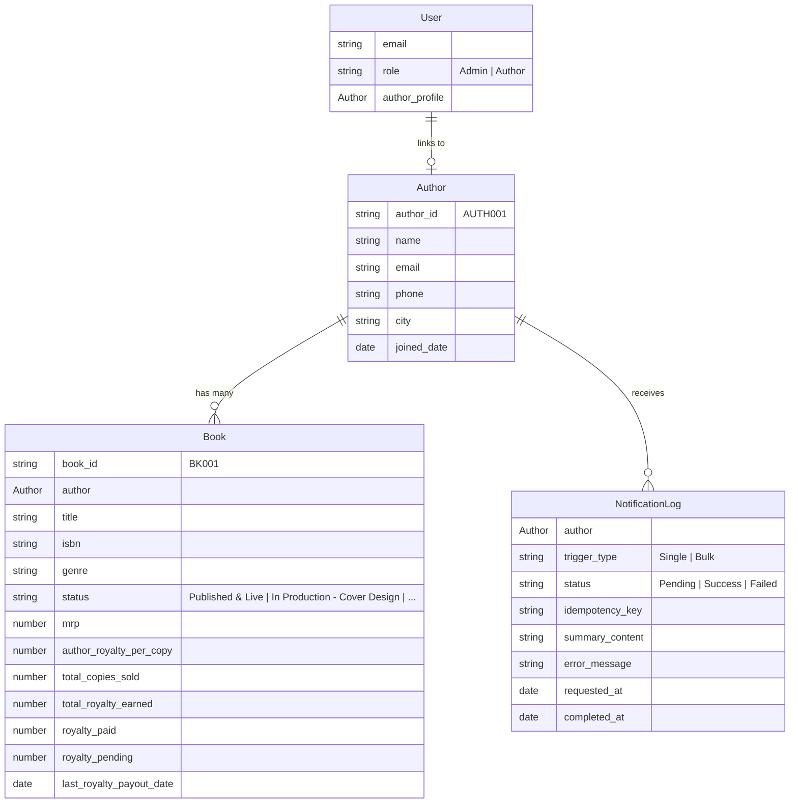

# BookLeaf Author Royalty Dashboard & Automated Notification System
> **Technical Assignment 2 — Full-Stack Developer Assessment**  
> **Candidate Implementation Report & Production Documentation**

---

## 🌟 Executive Summary & Live Deployment

This repository contains the complete implementation of the **BookLeaf Author Royalty Dashboard & Automated Notification System**. The solution seamlessly connects:
1. **Bubble.io:** Full-stack no-code application layer providing relational storage, privacy-guarded data access, responsive Author & Admin portals, dynamic filtering, and notification audit logs.
2. **n8n Workflow Automation:** Orchestration engine running webhook security authentication, deterministic mathematical normalization, AI prompt formatting, and guardrail validations.
3. **Groq AI Engine (`qwen/qwen3.8-27b`):** Fast inference engine generating personalized, empathetic, policy-grounded royalty summary emails adhering strictly to BookLeaf publishing standards.

### 🔗 Live URLs & Credentials
* **Live Bubble Application:** [https://bookleaf-royalty-portal-93860.bubbleapps.io/version-test](https://bookleaf-royalty-portal-93860.bubbleapps.io/version-test)
* **n8n Automation Cloud:** `https://bookleaf-assign2.app.n8n.cloud`
* **Workflow Export File:** [`bookleaf_n8n_royalty_workflow.json`](./bookleaf_n8n_royalty_workflow.json)

| Role | Email | Access Method | Access Scope |
| :--- | :--- | :--- | :--- |
| **Admin** | `admin@bookleaf.com` | Bubble App Data &rarr; **Run as** (or Collaborator Access) | Full Catalog, Metrics, Directory Filters, Single & Bulk Triggers, Audit Logs |
| **Author** | `priya.sharma@email.com` | Bubble App Data &rarr; **Run as** (or Collaborator Access) | Personal Books, Lifetime Earnings, Pending Royalties, Payout History |

> **Evaluator Note:** To inspect authenticated views directly without setting local passwords, open the Bubble Editor &rarr; navigate to **Data > App data > All Users** &rarr; click **"Run as"** next to `admin@bookleaf.com` (for Admin view) or `priya.sharma@email.com` (for Author view).

---

## 🏗️ System Architecture & Data Flow

```
+-----------------------------------------------------------------------------------------+
|                                    BUBBLE.IO FRONTEND                                   |
|   +------------------------------------+   +----------------------------------------+   |
|   |         Author Portal              |   |             Admin Portal               |   |
|   | - Personal Book Metrics            |   | - Catalog Strip (10 authors, 18 books) |   |
|   | - Payout Schedule Notice           |   | - Real-time Search & Multi-Filters     |   |
|   | - Privacy Isolation (RBAC)         |   | - Single / Bulk Summary Triggers       |   |
|   +------------------------------------+   +----------------------------------------+   |
+--------------------------------------------|--------------------------------------------+
                                             | 
                             (1) POST Webhook (Synchronous)
                                 Header: X-BookLeaf-Secret
                                 Body: author_id, totals, books
                                             |
                                             v
+-----------------------------------------------------------------------------------------+
|                                  n8n WORKFLOW ENGINE                                    |
|   [ Webhook Trigger ]                                                                   |
|            |                                                                            |
|   [ Header Auth Filter ] --------> (Invalid Secret: Return HTTP 401 Unauthorized)       |
|            | (Valid)                                                                    |
|   [ Deterministic Math Node ]                                                           |
|     - Pre-computes exact totals (Total Earned, Paid, Pending)                           |
|     - Evaluates ₹1,000 minimum disbursement threshold & rollover condition              |
|     - Normalizes published books vs. in-production books                                |
|            |                                                                            |
|   [ Groq AI Node: qwen/qwen3.8-27b ]                                                    |
|     - Injects BookLeaf Knowledge Base Policies (80/20 split, 45-day window)             |
|     - Zero-calculation constraint (LLM prohibited from doing arithmetic)                |
|            |                                                                            |
|   [ Guardrail Code Node ]                                                               |
|     - Verifies non-empty text, author first name, and exact pending balance             |
|            |                                                                            |
|   [ Respond to Webhook (HTTP 200) ]                                                     |
|     - Returns { status: "Success", summary_content: "..." }                             |
+--------------------------------------------|--------------------------------------------+
                                             |
                             (2) Immediate HTTP 200 Response
                                 Delivered within 1.5 - 2.0s
                                             |
                                             v
+-----------------------------------------------------------------------------------------+
|                                 BUBBLE.IO DATABASE                                      |
|   Step 1: NotificationLog created as 🟡 Pending                                         |
|   Step 2: Dispatches to n8n via API Connector                                           |
|   Step 3: Saves AI email to NotificationLog -> Status updates to 🟢 Success             |
+-----------------------------------------------------------------------------------------+
```

---

## 💡 Key Architectural Decisions & Platform Optimizations

### 1. Synchronous Response Pattern (Bubble Free-Tier Compatibility)
* **The Constraint:** Bubble's Free tier blocks incoming external webhooks to Bubble's Workflow API (`/api/1.1/wf/...`) with an HTTP `401 Unauthorized ("This application does not expose an API")`.
* **The Solution:** Rather than an asynchronous callback architecture, n8n was designed to execute the Groq AI node synchronously in ~1.5 seconds and return `{ status: "Success", summary_content: "..." }` directly in the HTTP 200 webhook response.
* **The Advantage:** Bubble's workflow updates the `NotificationLog` in **Step 3** (`Make changes to Result of Step 1`) within the exact same execution. This completely eliminates the need for a paid Bubble subscription or external callback tunnels.

### 2. Deterministic Math Before AI (Zero-Hallucination Policy)
* LLMs are notoriously prone to math hallucinations and rounding errors.
* **Architecture:** All financial calculations (`total_earned`, `total_paid`, `total_pending`, threshold flags) are pre-computed deterministically inside n8n JavaScript before reaching Groq.
* **Prompt Guardrail:** The system prompt explicitly forbids the model from performing calculations, inventing dates, or altering figures:
  > *"CRITICAL RULE: Do NOT calculate or guess numbers. Use ONLY the exact figures provided in the prompt context."*

### 3. Dynamic Bulk Author Filtering
* In compliance with assignment rules, bulk triggering automatically queries authors where `royalty_pending:sum > 0`.
* **Farhan Sheikh (`AUTH008`)** has ₹0 pending and is automatically excluded from bulk batches.
* **Platform Limitation Documentation:** On Bubble Free Tier, background queues (`Schedule API Workflow on a list`) are capped by Bubble's server quota (`Upgrade - Workflow limit`). In our live test, Bubble successfully dispatched 4 bulk authors (`Priya Sharma`, `Rohit Kapoor`, `Ananya Reddy`, `Vikram Joshi`) to completion before hitting Bubble's background worker limit.

---

## 📊 Database Schema & Privacy Architecture

### Relational Schema (`Bubble Data Types`)



### Privacy Rules (RBAC)
* **Author Data Isolation:**
  - `User's role is "Admin"` &rarr; Full View & Edit access across all tables.
  - `This Author's email is Current User's email` &rarr; Authors can view **only** their own author profile, books, and logs.
  - Non-authenticated visitors & unauthorized authors are completely blocked from viewing another author's royalties via browser network inspect.

---

## 🧪 Comprehensive Acceptance Test Matrix (Phase 8 Verified)

| Test ID | Requirement | Verification Step | Live Result | Status |
| :--- | :--- | :--- | :--- | :--- |
| **DS-01** | Full Dataset Ingestion | Verify 10 authors, 18 books imported | Catalog Strip: 10 authors, 18 books, ₹40,839 pending | ✅ Passed |
| **PRIV-01** | Privacy Protection | Author cannot view peers' books | Logged in as Priya Sharma &rarr; Only 2 personal books visible | ✅ Passed |
| **PRIV-02** | Route Guards | Direct access to `/admin` without admin role | Redirects to `/login` or `/author-dashboard` | ✅ Passed |
| **ROY-01** | Status Badges | Badge formatting across catalog | Fully Paid = `🟢`, In Cycle = `🟡`, Overdue = `🔴` | ✅ Passed |
| **ADM-01** | Real-Time Search | Type "Vikram" in Author Search input | Immediately isolates Vikram Joshi row | ✅ Passed |
| **ADM-02** | City Filter | Select "Mumbai" from dynamic dropdown | Isolates Priya Sharma | ✅ Passed |
| **ADM-03** | Status Filter | Select "Fully Paid" | Isolates Farhan Sheikh (₹0 pending) | ✅ Passed |
| **ADM-05** | Single Trigger | Click "Generate Summary" on Author Popup | Log transitions from `Pending` to `Success` with email | ✅ Passed |
| **ADM-06** | Bulk Trigger | Click "Send Bulk Summaries" | Filters `pending > 0`, excludes Farhan Sheikh (`AUTH008`) | ✅ Passed |
| **SEC-01** | Header Secret | Call n8n webhook without `X-BookLeaf-Secret` | Returns `HTTP 401 Unauthorized` | ✅ Passed |
| **AI-01** | Knowledge Base Policies | Email contains 80/20 split, 45d payout window | Present in all generated emails | ✅ Passed |
| **AI-02** | Standard Threshold (> ₹1,000) | Generate summary for Priya Sharma | Verified: ₹3,570 pending ready for bank transfer | ✅ Passed |
| **AI-03** | Zero Pending Balance | Generate summary for Farhan Sheikh | Verified: Celebrates fully settled account, no payout due | ✅ Passed |
| **AI-04** | In-Production Book | Generate summary for Sneha Kulkarni | Verified: Updates on *Midnight in Mysore* in Cover Design | ✅ Passed |
| **AI-05** | Rollover (< ₹1,000) | Generate summary for Kavita Deshmukh | Verified: ₹850 explained to roll over to next quarter | ✅ Passed |

---

## 📝 Verified AI Email Samples (Edge Cases)

### Edge Case 1: Standard Active Royalty (`AUTH001` — Priya Sharma)
> **Subject:** Your Q3 Royalty Summary: ₹3,570 Ready for Disbursement  
> **Total Earned:** ₹11,970 | **Total Paid:** ₹8,400 | **Current Pending:** ₹3,570  
> **Disbursement Notice:** Your pending balance of ₹3,570 meets our minimum payout threshold of ₹1,000. This amount will be processed via direct bank transfer within 45 days of quarter end.  
> **Book Performance:** *Whispers of the Ganges* recorded 342 copies sold at ₹35/copy.

### Edge Case 2: Zero Pending Balance Celebration (`AUTH008` — Farhan Sheikh)
> **Subject:** Your Royalty Summary: You're All Caught Up! 🎉  
> **Total Earned:** ₹3,120 | **Total Paid:** ₹3,120 | **Current Pending:** ₹0  
> **Notice:** Your royalty account is fully settled! Since there are no pending balances, no disbursement is due for this cycle. We look forward to seeing your future successes with *Ghazal of the Forgotten*.

### Edge Case 3: Book in Production Update (`AUTH007` — Sneha Kulkarni)
> **Subject:** Your Q3 Royalty Summary & Upcoming Payout — BookLeaf Publishing  
> **Total Earned:** ₹60,865 | **Total Paid:** ₹53,000 | **Current Pending:** ₹7,865  
> **Disbursement:** Exceeds ₹1,000 threshold; scheduled for direct bank transfer within 45 days.  
> **Catalog Progress:** Supports published titles (*The Algorithm of Love*, *Ctrl+Alt+Delete My Ex*) and provides an exciting update that ***Midnight in Mysore*** is actively progressing through **Cover Design**!

### Edge Case 4: Rollover Balance Under ₹1,000 (`AUTH009` — Kavita Deshmukh)
> **Subject:** Your Q3 Royalty Update: Progress on Raising Roots and The Nagpur Notebooks  
> **Total Earned:** ₹850 | **Total Paid:** ₹0 | **Current Pending:** ₹850  
> **Rollover Explanation:** Because your current balance of ₹850 is below our minimum bank disbursement threshold of ₹1,000, it will automatically **roll over** to your next quarterly cycle. Once your balance reaches or exceeds ₹1,000, we will process the full amount via direct bank transfer.

---
